# TY HD Renderer

**Same game, same art, better light.**

TY HD Renderer is a rendering mod for **TY the Tasmanian Tiger** on PC. It changes how the outback is lit and shaded, and it leaves the game itself alone. Pick a preset, press Play, and the bush gets a little more depth.

**Status:** community beta. The latest release is v0.3.5. Changes on `main` since then are listed in [CHANGELOG.md](CHANGELOG.md). They are not playtested yet.

Tested on one graphics card: AMD Radeon RX 7600 XT on Windows 11. NVIDIA, Intel and Linux/Proton are not tested yet, and reports from those are very welcome.

## What it changes

TY's art is bold and flat, and the lighting underneath it is old. Shadows are hard and capped at 50%. Distant rocks fade into a flat colour. Surfaces have no depth beyond their paint. Light never bounces off anything.

The mod fixes those four things and keeps the look:

- **Shadows.** Softer edges, a larger shadow map, and a cooler shade colour, so shade reads as shade.
- **Surface relief.** Cracks, grain, wood and rope get bumps and roughness from their own colour. Feet stay on the ground, and characters are not changed.
- **Contact shadows.** Ambient occlusion (AO) darkens crevices and corners. It fades with distance and stays steady from frame to frame.
- **Haze.** Volumetric fog with light shafts. Distant rocks lose a little colour, and the haze follows the real sky.
- **Bounce light** (High and Ultra). Surfaces pick up a little colour from their neighbours.
- **Smoother image.** TAA or FXAA for edges, with gentle sharpening and grading.
- **A launcher with sliders.** Every effect has a slider, a short description and a rough cost, and your settings are saved.

Nothing in the game files is changed. The original `TY.exe` is never modified, so to remove the mod, delete its files.

## Side by side

Each pair is an F11 capture from one playtest, on build `cda9364` and the **Ultra** preset. Left is shaders off, right is shaders on.

There are eight pairs, so treat them as a sample rather than a full test. Ultra is the slowest preset, so Medium will show less difference. **Read this first:** the F11 "shaders off" frame is not stock. The hotkey only switches off surface relief and the material extras (PBR). Ambient occlusion, bounce light, fog, shadows and anti-aliasing stay on in both frames. So these pairs show the relief and material part of the mod only. They are not a full before and after, and they should not be read as proof of shadow, AO, bounce light or fog differences. A true before and after set will replace them after the F11 fix and the next playtest.

All images are in [`docs/ab/`](docs/ab/).

### Ground and props

<table>
<tr>
<th align="left">Shaders off</th>
<th align="left">Shaders on</th>
</tr>
<tr>
<td>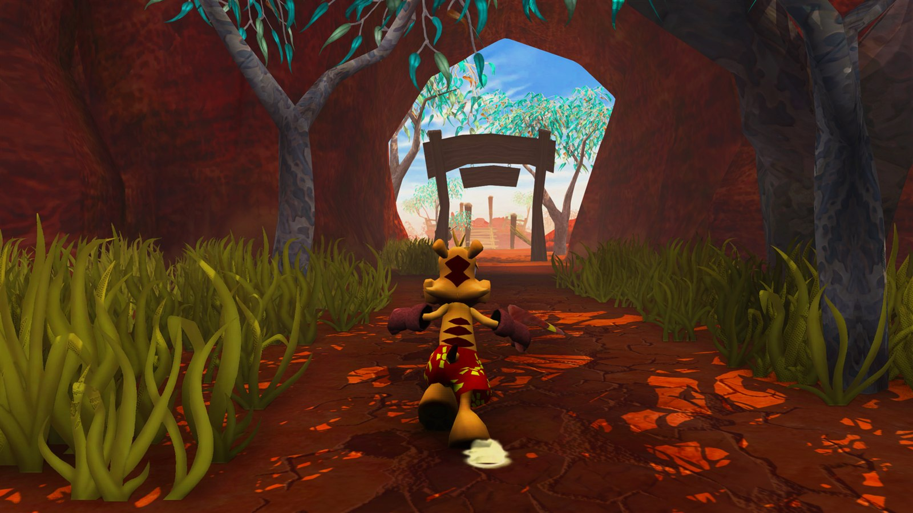</td>
<td>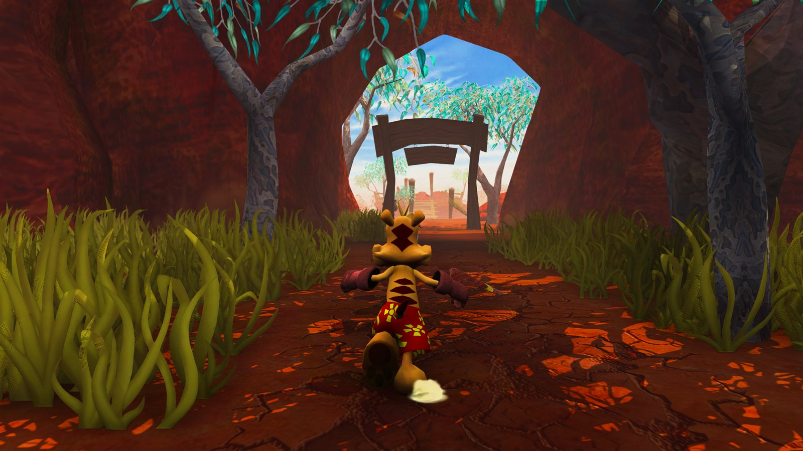</td>
</tr>
<tr>
<td colspan="2"><b>04 Forest arch.</b> Under the wooden arch at the forest tunnel exit.</td>
</tr>
<tr>
<td>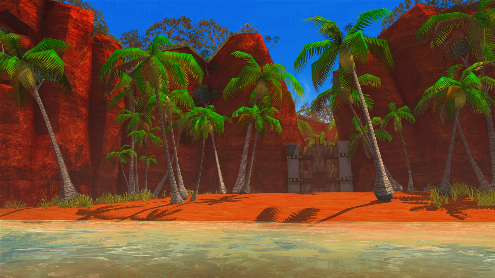</td>
<td>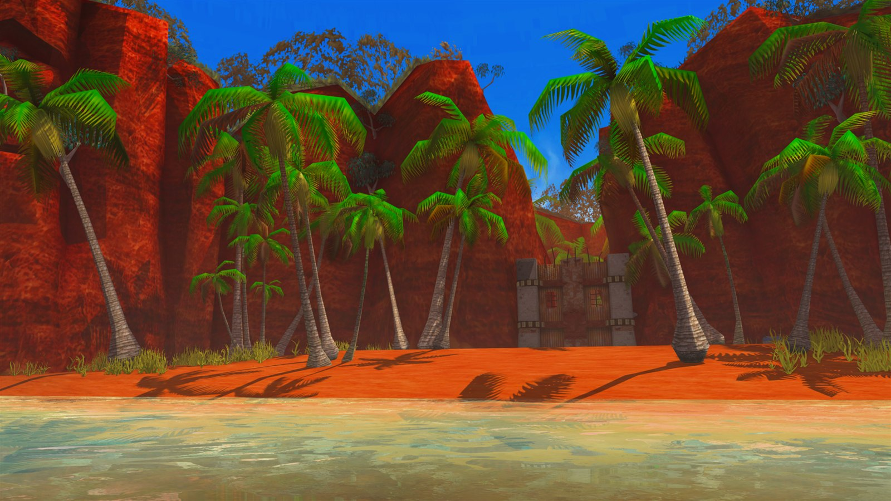</td>
</tr>
<tr>
<td colspan="2"><b>01 Beach and fort.</b> Beach, red cliffs, palms and the ruined fort.</td>
</tr>
</table>

### Close-ups

<table>
<tr>
<th align="left">Shaders off</th>
<th align="left">Shaders on</th>
</tr>
<tr>
<td>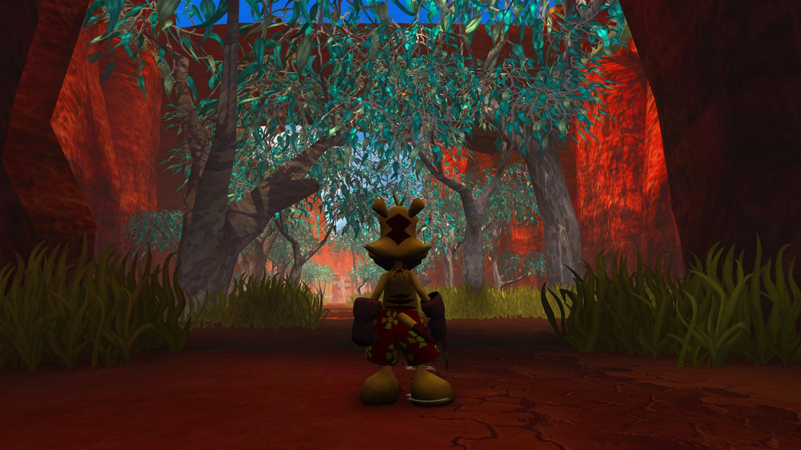</td>
<td>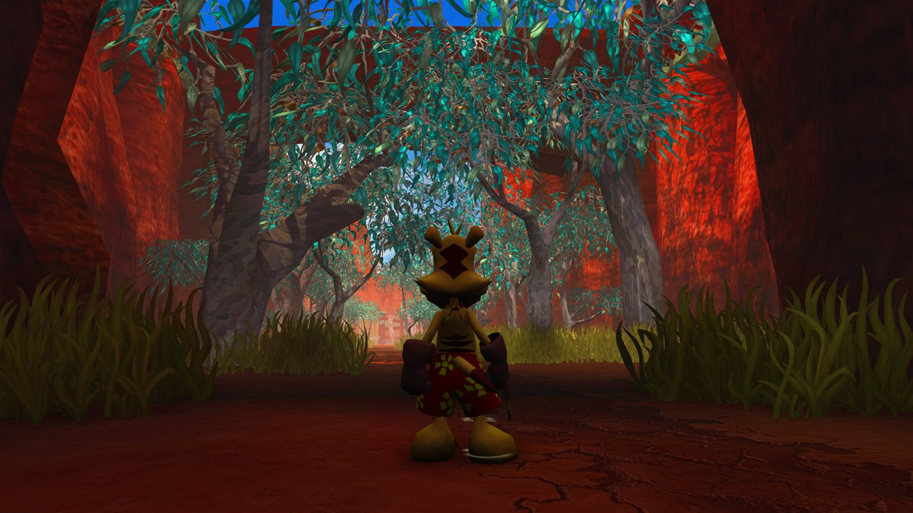</td>
</tr>
<tr>
<td colspan="2"><b>06 Canopy close-up.</b> Close-up of Ty under the canopy.</td>
</tr>
<tr>
<td>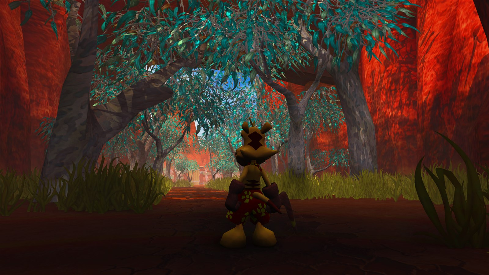</td>
<td></td>
</tr>
<tr>
<td colspan="2"><b>05 Canopy path at dusk.</b> Ty on the canopy path at dusk.</td>
</tr>
</table>

### Grass and fences

<table>
<tr>
<th align="left">Shaders off</th>
<th align="left">Shaders on</th>
</tr>
<tr>
<td>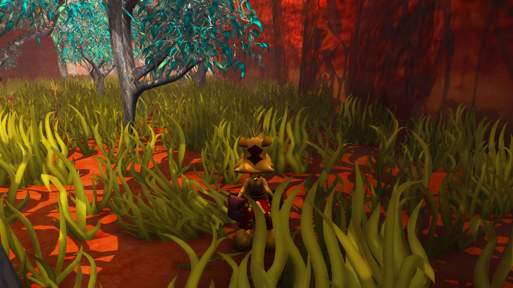</td>
<td>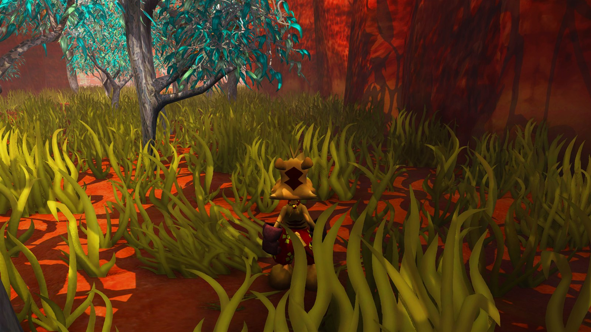</td>
</tr>
<tr>
<td colspan="2"><b>07 Tall grass.</b> Ty in tall grass.</td>
</tr>
<tr>
<td>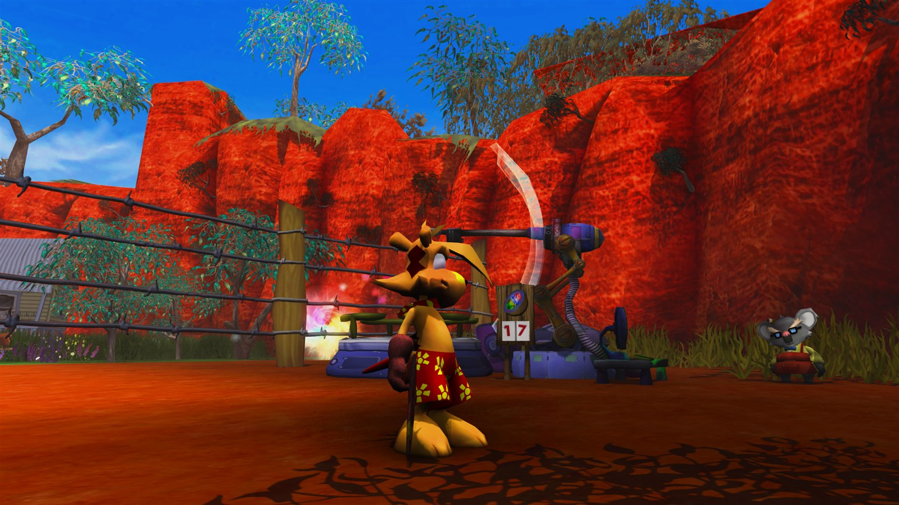</td>
<td>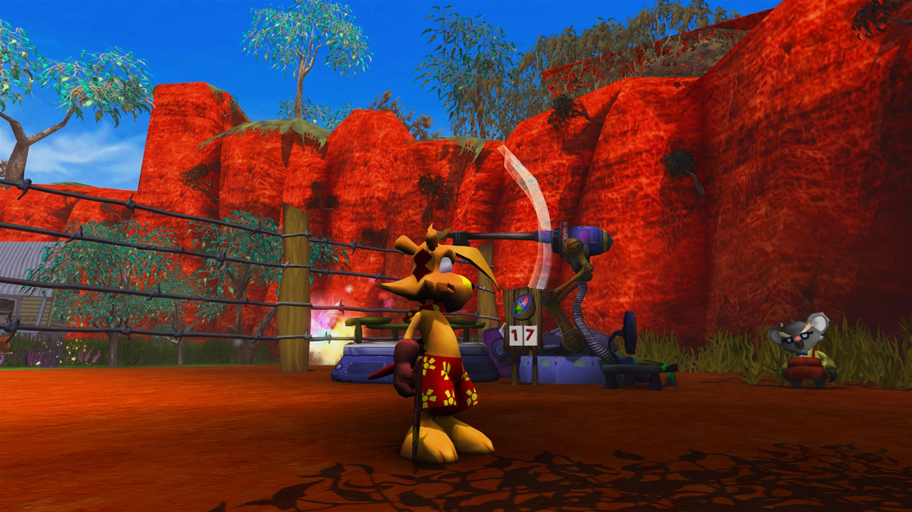</td>
</tr>
<tr>
<td colspan="2"><b>08 Fence and counter.</b> The fence, the counter showing 17, a sign and a machine.</td>
</tr>
</table>

### Water and the portal (known gaps)

<table>
<tr>
<th align="left">Shaders off</th>
<th align="left">Shaders on</th>
</tr>
<tr>
<td>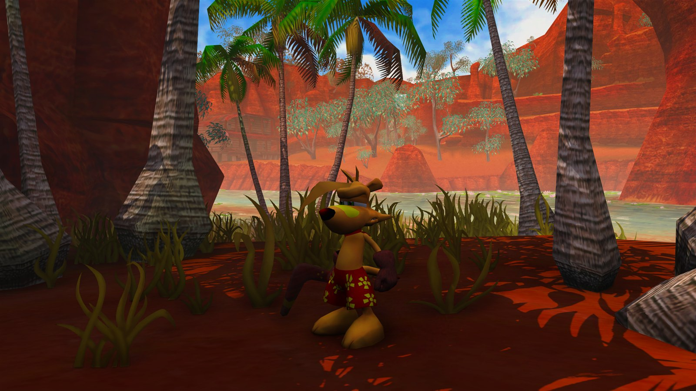</td>
<td>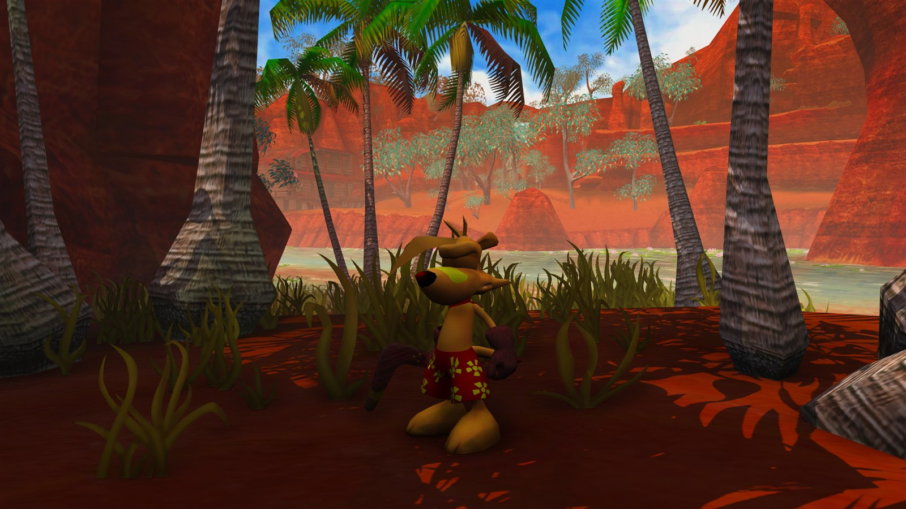</td>
</tr>
<tr>
<td colspan="2"><b>02 Palm grove by the water.</b> The water is not changed by this comparison. The blue flicker on Ty in water is a known issue.</td>
</tr>
<tr>
<td>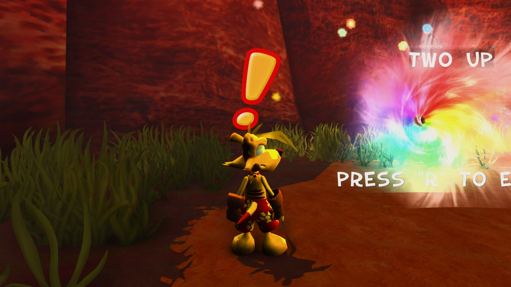</td>
<td>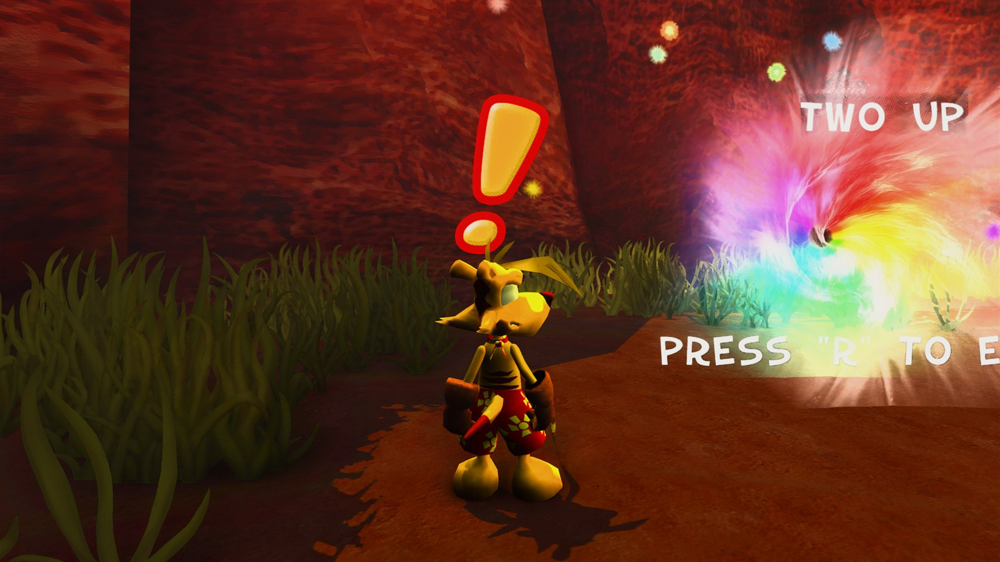</td>
</tr>
<tr>
<td colspan="2"><b>03 Rainbow portal.</b> Ty next to the rainbow portal. The portal does not light the ground yet (known issue).</td>
</tr>
</table>

**Fog and haze are not in these pairs.** F11 does not switch them off, so no pair shows them. Far trees and the sky on the second level are not fully fogged, which is a known issue. See [Known issues](#known-issues).

## Presets

Frame times are GPU milliseconds per frame, measured by the author at 2560x1440 windowed on one AMD Radeon RX 7600 XT. Other GPUs will be faster or slower. Lower is faster.

| Preset | Frame time | About fps | What it adds |
|---|---|---|---|
| Stock game (no mod) | 5.7 ms | 175 | The original game, for comparison |
| Low | about 6.0 ms | 166 | FXAA smoothing and 2048 shadow maps. No soft corner shadows, no haze |
| **Medium** (recommended, default) | about 12 ms | 80 | Soft corner shadows, haze, surface relief, 4096 shadow maps, TAA smoothing. No bounce light |
| High | about 18 ms | 55 | Medium plus bounce light (1 ray) and contact shadows |
| Ultra | about 31 ms | 32 | More AO samples, bounce light (2 rays), higher-quality haze, environment relief, 8192 shadow maps |

Medium is the stable preset in playtests. High and Ultra flickered in playtest 4, so use Medium if you see flicker.

### What each option costs

Measured against Medium, on one GPU:

| Option | Change | Rough frame cost |
|---|---|---|
| Ambient occlusion (AO) | Off | saves about 1.15 ms |
| Volumetric haze | Off | saves about 2.1 ms |
| Contact shadows | On | about +1.7 ms |
| Bounce light | On, 1 ray | about +4.4 ms |
| Shadow maps | 8192, 32 taps | about +5.1 ms |
| Environment relief | `[tess] Scope=env` | about +6.2 ms |

These are approximate, because effects interact. They come from the v0.3 measurements in [`docs/PERFORMANCE.md`](docs/PERFORMANCE.md). The v0.3.2 changes have not been timed one by one.

## Install

1. Download `TYLauncher.exe` from the release.
2. Put it in the game folder, next to `TY.exe`.
3. Run `TYLauncher.exe`, pick a preset (Medium is the recommended one) and press **Play with HD renderer**.
   The first start installs the renderer files next to it. The first Play creates `TY_tyrender.exe`, a copy of `TY.exe` that loads `tyrender.dll`. `TY.exe` itself is never changed.
4. Keep the launcher open to move the sliders. Most of them apply live.
5. Optional: **Steam setup** copies a launch option. Paste it into Steam > TY the Tasmanian Tiger > Properties > General > Launch options, and Steam's Play button will start the mod.

The launcher is a single file. The renderer DLL and default settings are built into it. The title bar shows the version and build id.

**Play original (no mod)** starts the untouched game. **Advanced (ini)...** opens `tyrender.ini`.

**Memory:** `TY_tyrender.exe` is marked Large Address Aware (4 GB instead of 2 GB). Without this, the 32-bit game can run out of memory with the HD texture pack (log line: `CMKHeap - Out of memory`).

## Uninstall

Delete `tyrender.dll`, `TYLauncher.exe`, `TY_tyrender.exe`, `tyrender.ini`, `tyrender.log`, and the `tyrender` folder if it exists. If you added the Steam launch option, remove it in Steam. The original game keeps working without these files.

## Known issues

These are open from playtests. Where a fix is on `main`, it is marked untested.

- **Water:** Ty flickers blue in water (#5). A fix is on `main` but has not been confirmed in a playtest.
- **Fog on distant scenery:** far trees and the sky on the second level are not fully fogged (#4).
- **Portal light:** the rainbow portal does not light the ground, and fire is not yet hazed by the fog (#9).
- **Character shadows:** a thin bright line can run through the shadow edge on characters (face, bag), and the shadow looks slightly grid-like.
- **Dark halo:** a dark halo can appear behind a character, on the side away from the camera.
- **White rim:** fern shadows on the ground have a white rim.
- **High and Ultra flicker:** use Medium if you see it.
- **Ultra is slow:** about 31 ms per frame on the test card.
- **Thin objects:** rope and grass get little benefit from relief, because their source textures are flat.
- **Trails:** TAA can leave a faint trail on fast animation.
- **Low-resolution textures:** relief comes from the texture's own colour, so it is weaker on low-resolution textures.
- **Shimmer:** shimmer during fast camera moves has not been measured formally.
- **F10 overlay:** the in-game settings overlay broke geometry in playtest, so it is off by default. It is not a supported feature yet.
- **Game version:** built against the 2020-04-04 `TY.exe`. Other builds are untested.

## Reporting problems

Send your `tyrender.log`, a screenshot (the F11 hotkey takes comparison shots), your GPU model and your driver version. NVIDIA and Intel owners: a `tyrender.log` from one run is especially welcome, since those GPUs are untested.

## Compatibility and credits

- Works with the base game.
- Gets more from the ty2k mod, because more texture detail means more precise relief.
- The HD texture pack is separate from this project.
- A hobby project, made with Claude for the community. Thank you to everyone who tested and sent reports.

## For modders

Presets cover most needs, and the launcher writes the values it needs. To tune by hand, edit `tyrender.ini` in the game folder, or open it from **Advanced (ini)...** in the launcher. Per-option costs are in [`docs/PERFORMANCE.md`](docs/PERFORMANCE.md).

If a graphics card or driver cannot run an effect (for example no GL 4.3 compute for the fog, or a shader that does not compile), **that effect switches itself off** and the frame is drawn without it. The renderer does not fall back to a slower path. Check `tyrender.log` for the reason.

Settings reference (tyrender.ini)

Live means the change applies while the game runs (through the launcher or the `tyrender\reload` file). Restart means the game must be restarted.

| Section | Key | Default in code | Meaning |
|---|---|---|---|
| `[ao]` | Enable | 1 | AO on or off |
| `[ao]` | Slices / Steps | 3 / 6 | AO quality (Ultra uses 4 / 8) |
| `[ao]` | Radius / Strength / Power | 60 / 0.85 / 1.0 | Crevice AO look |
| `[ao]` | WideRadius / WideStrength / WideSlices | 400 / 1.0 / 0 (= Slices) | Corner darkening over a larger area |
| `[ao]` | Thin / MultiBounce | 0.5 / 0.6 | Thin objects (grass, fence) and bounce darkening |
| `[ao]` | Temporal / TemporalMode / TemporalBlend | 1 / 1 / 0.85 | Temporal smoothing (mode 1 = bilinear history with variance clamp; 0 = the v0.3.1 method) |
| `[ao]` | NoiseFrames / BlurRadius / BlurFalloff | 64 / 2 / 0.15 | Noise pattern and denoise filter |
| `[ao]` | FogFade | 1.0 | AO fades with fog (0 = AO ignores fog, the old behaviour) |
| `[ao]` | Legacy | 0 | 1 = the older, slower AO (not recommended) |
| `[ao]` | DebugView | 0 | 1 = show AO only (test aid) |
| `[gi]` | Enable | 1 in code, 0 in the shipped ini and in Low/Medium | Bounce light on or off |
| `[gi]` | Mode / Rays / Steps | 1 / 4 / 8 | Method 1 = Hi-Z (recommended); presets use 1 ray (High) or 2 rays (Ultra) |
| `[gi]` | Strength / Radius / Thickness | 0.7 / 400 / 120 | Look |
| `[gi]` | Characters | 1 | Characters take part in bounce light |
| `[gi]` | CharacterColour | 0.0 | How much of a character's colour is passed on (0 = none) |
| `[gi]` | CharacterGI | 0.3 | How much light the character receives from the scene |
| `[gi]` | CharacterHeight / CharacterRadius | 160 / 70 | Size of the mask around a character |
| `[atmos]` | Enable / Froxel / Steps | 1 / 1 / 24 | Volumetric fog on or off, compute method, quality |
| `[atmos]` | Intensity | 2.5 in code (presets write 2.2) | Overall haze amount (live) |
| `[atmos]` | Desaturation / HazeLift | 0.7 / 0.35 | Far rocks lose colour and get lighter |
| `[atmos]` | HazeSky | 0.6 | Haze colour follows the real sky (0 = old look) |
| `[atmos]` | SkyHaze / SkyHazeHeight | 0.5 / 0.25 | Haze on the sky and horizon |
| `[atmos]` | HazeHue | 0.25 | How much haze takes the sky's hue |
| `[atmos]` | ShaftContrast / ContactShadows / ContactLength | 0.5 / 0 / 25 | Light shafts and contact shadows toward the sun (ContactShadows > 0 costs time) |
| `[atmos]` | DepthBlur / BlurStart / BlurRange | 0 / 4000 / 12000 | Optional blur of distant scenery (try 2 to 3; off by default) |
| `[shadows]` | Patch | 1 | Use the new shadow filter |
| `[shadows]` | MapScale | 2 | 1 = 2048, 2 = 4096, 4 = 8192 (restart) |
| `[shadows]` | Taps | 16 | Filter taps (restart). With `Grid=1` the grid is 3x3 (Medium) or 4x4 (Ultra) |
| `[shadows]` | Grid | 1 | Fixed filter grid, no per-pixel noise (recommended) |
| `[shadows]` | Temporal | 0 | Shadow pattern changes per frame (not recommended) |
| `[shadows]` | Radius / Strength / GrassStrength | 1.4 / 0.5 / 0.35 (launcher) | Softness, shadow darkness, grass shadow strength |
| `[post]` | Enable / AA | 1 / 2 | AA: 0 = none, 1 = FXAA, 2 = TAA, 3 = TAA + FXAA |
| `[post]` | Sharpen / SharpenHaloClamp | 0.25 / 1 | Sharpening amount; clamp stops dark and bright halos |
| `[post]` | Contrast / Saturation / Vibrance | 1.0 / 1.0 / 0.04 | Grade |
| `[post]` | Shoulder / Vignette / Gamma | 0.12 / 0 / 1.0 | Grade |
| `[tess]` | Enable | 1 | Relief on or off |
| `[tess]` | Scope | env-detail | `env-detail` = relief on the ground and props (default); `env` or `all` = also tessellate the environment (about +4 to +6 ms, Ultra only); `off` = nothing |
| `[tess]` | Alpha / TargetPx / MaxLevel | 0.7 / 12 / 8 | Tessellation detail (restart) |
| `[tess]` | ReliefSteps / ReliefFeature / ReliefDepth | 8 / 1.0 / 3 | Relief quality and depth. ReliefDepth is the launcher's "Surface relief" slider |
| `[tess]` | ReliefCurve / ReliefKnee / ReliefKneeSlope | 1.0 / 0 / 0.35 | Relief shaping. Curve below 1 lifts weak relief (the floor rises). Knee (world units, 0 = off) makes relief past it grow at KneeSlope of its rate, so strong textures stop growing when ReliefDepth goes up |
| `[pbr]` | Enable | 1 | Bump and specular from the texture (restart) |
| `[pbr]` | DetailStrength / DetailScale / DetailDisp | 1.0 / 1.0 / 0.8 | Relief strength, scale, inward depth |
| `[pbr]` | LitProps | 1 | 0 = props keep the stock look |
| `[light]` | Enable / ShadowTint / Hemisphere / Foliage | 1 / 1 / 1 / 1 | Natural light; each `*Amount` key scales its part |
| `[debug]` | ForceFallback | 0 | Test aid: bits 1 fog, 2 GI, 4 AO, 8 relief, 16 light shaders are forced to fail |
| `[debug]` | StateGuard | 0 | Test aid: logs graphics-state changes |

The shipped `tyrender.ini` is the Medium preset. The launcher writes the values it needs, so you normally do not need to edit the file by hand.

## Changes and history

Release notes are in [CHANGELOG.md](CHANGELOG.md). Builds are identified by the git commit in the launcher title bar.
